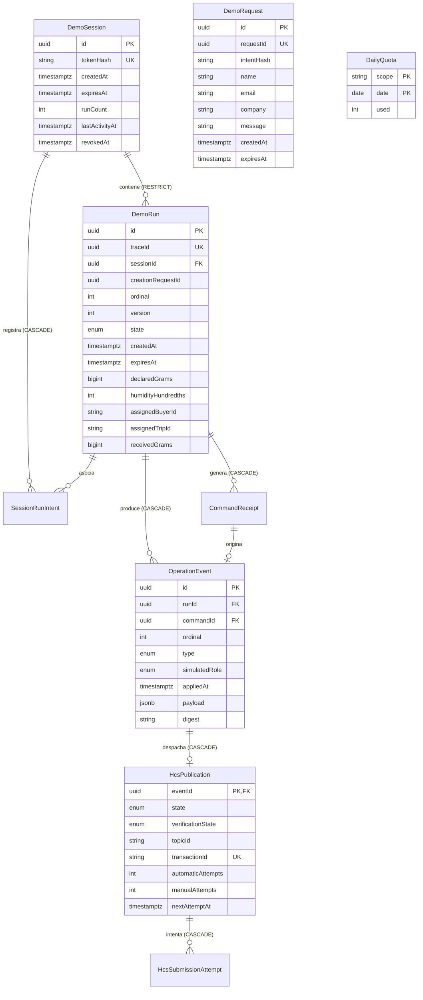

# Modelo de Datos — Jopói

Este documento detalla el esquema de persistencia relacional implementado en **PostgreSQL 16** a través de **Prisma ORM**, incluyendo el diagrama entidad-relación, el diccionario de datos, las políticas de integridad referencial y la clasificación de privacidad de datos.

La fuente de verdad ejecutable del esquema es [`prisma/schema.prisma`](file:///C:/Users/Facundo/dev/jopoi/prisma/schema.prisma).

---

## 1. Diagrama Entidad-Relación (Mermaid)

---

## 2. Diccionario de datos

### 2.1 Tabla `DemoSession` (Sesión efímera anónima)
| Campo | Tipo | Nulo | Descripción |
| :--- | :--- | :---: | :--- |
| `id` | UUID (PK) | No | Identificador unívoco de la sesión. |
| `tokenHash` | VARCHAR(64) (UK) | No | Hash SHA-256 del token provisto en la cookie de sesión. |
| `createdAt` | TIMESTAMPTZ | No | Fecha y hora de creación de la sesión. |
| `expiresAt` | TIMESTAMPTZ | No | Momento de expiración (24 horas tras la creación). |
| `runCount` | SMALLINT | No | Contador de recorridos consumidos (máximo 3). |
| `lastActivityAt` | TIMESTAMPTZ | No | Último acceso o comando ejecutado por la sesión. |
| `revokedAt` | TIMESTAMPTZ | Sí | Marca temporal en caso de revocación manual o cierre forzado. |

### 2.2 Tabla `DemoRun` (Recorrido operativo de lote)
| Campo | Tipo | Nulo | Descripción |
| :--- | :--- | :---: | :--- |
| `id` | UUID (PK) | No | Identificador unívoco interno del recorrido. |
| `traceId` | UUID (UK) | No | Identificador público para consulta y código QR. |
| `sessionId` | UUID (FK) | No | Sesión propietaria del recorrido (`DemoSession.id`). |
| `ordinal` | SMALLINT | No | Número secuencial del recorrido dentro de la sesión (1, 2 o 3). |
| `version` | INT | No | Versión de control optimista para detección de colisiones (`ETag`). |
| `state` | ENUM | No | Estado actual: `DRAFT`, `PUBLISHED`, `APPROVED`, `ASSIGNED`, `PICKED_UP`, `RECEIVED`, `REJECTED`, `INCIDENT`. |
| `declaredGrams` | BIGINT | No | Cantidad declarada en gramos de biomasa (`RN-01`). |
| `humidityHundredths` | SMALLINT | No | Porcentaje de humedad en centésimas (ej. 3200 = 32.00%). |
| `assignedBuyerId` | VARCHAR(64) | Sí | Identificador del comprador seleccionado en el escenario. |
| `assignedTripId` | VARCHAR(64) | Sí | Identificador del viaje de transporte compatible asignado. |
| `receivedGrams` | BIGINT | Sí | Peso recibido en destino registrado por el comprador. |
| `expiresAt` | TIMESTAMPTZ | No | Caducidad del recorrido (7 días tras su inicio). |

### 2.3 Tabla `OperationEvent` (Hitos del dominio inmutables)
| Campo | Tipo | Nulo | Descripción |
| :--- | :--- | :---: | :--- |
| `id` | UUID (PK) | No | Identificador único del evento. |
| `runId` | UUID (FK) | No | Recorrido al que pertenece el evento. |
| `commandId` | UUID (FK) | No | Recibo del comando que originó este evento. |
| `ordinal` | INT | No | Secuencia del evento dentro del recorrido (1 a 5). |
| `type` | ENUM | No | Tipo: `LOT_PUBLISHED`, `LOT_APPROVED`, `LOT_REJECTED`, `TRANSPORT_ASSIGNED`, `PICKUP_CONFIRMED`, `RECEIPT_ACCEPTED`, `RECEIPT_ISSUE_REPORTED`. |
| `simulatedRole` | ENUM | No | Rol que ejecutó la acción: `GENERATOR`, `COORDINATOR`, `CARRIER`, `BUYER`. |
| `payload` | JSONB | No | Contenido estructurado de la declaración. |
| `digest` | VARCHAR(64) | No | Hash SHA-256 canónico RFC-8785 (JCS) del payload (`RN-14`). |

### 2.4 Tabla `HcsPublication` (Publicación en Hedera Testnet)
| Campo | Tipo | Nulo | Descripción |
| :--- | :--- | :---: | :--- |
| `eventId` | UUID (PK, FK) | No | Evento asociado (`OperationEvent.id`). |
| `state` | ENUM | No | `QUEUED`, `IN_FLIGHT`, `UNCERTAIN`, `CONFIRMED`, `FAILED`, `PAUSED_QUOTA`, `PAUSED_CONFIG`. |
| `verificationState` | ENUM | No | `NOT_CHECKED`, `PENDING`, `MATCHED`, `MISMATCH`, `UNAVAILABLE`. |
| `transactionId` | VARCHAR(128) (UK) | Sí | Identificador oficial de transacción en Hedera. |
| `sequenceNumber` | BIGINT | Sí | Número de secuencia asignado por el consenso de HCS. |
| `consensusTimestamp`| VARCHAR(30) | Sí | Timestamp de consenso certificado por Hedera. |

### 2.5 Tabla `DemoRequest` (Solicitudes de contacto comercial)
| Campo | Tipo | Nulo | Descripción |
| :--- | :--- | :---: | :--- |
| `id` | UUID (PK) | No | Identificador único del contacto. |
| `requestId` | UUID (UK) | No | Token de idempotencia provisto por el formulario. |
| `name` | TEXT | No | Nombre completo del solicitante. |
| `email` | TEXT | No | Dirección de correo electrónico de contacto. |
| `company` | TEXT | No | Nombre de la empresa u organización. |
| `message` | TEXT | Sí | Mensaje o consulta opcional. |
| `expiresAt` | TIMESTAMPTZ | No | Caducidad física del contacto (90 días desde el envío). |

---

## 3. Políticas de integridad referencial

| Relación | Acción al borrar padre (`ON DELETE`) | Justificación técnica y operativa |
| :--- | :---: | :--- |
| `DemoSession → DemoRun` | **`RESTRICT`** | **Protección de auditoría:** No se permite borrar una sesión mientras existan recorridos activos asociados. Evita la pérdida accidental de datos durante recorridos en curso. |
| `DemoRun → SessionRunIntent` | **`CASCADE`** | Las intenciones de sesión pertenecen exclusivamente al ciclo de vida del recorrido. |
| `DemoRun → CommandReceipt` | **`CASCADE`** | Los recibos de comando son auditoría local ligada al recorrido; se purgan en conjunto en el barrido diario. |
| `DemoRun → OperationEvent` | **`CASCADE`** | Al caducar un recorrido tras 7 días, sus eventos locales se eliminan físicamente (el anclaje en HCS persiste en la red externa). |
| `OperationEvent → HcsPublication`| **`CASCADE`** | El registro de despacho Outbox es dependiente del evento originario. |

---

## 4. Clasificación y privacidad de datos (Ley 25.326)

Conforme a la **Ley Nacional 25.326 de Protección de Datos Personales (Argentina)** y los principios de minimización de datos:

| Tabla / Campo | Clasificación | Nivel de Exposición | Tratamiento y Salvaguardas |
| :--- | :--- | :--- | :--- |
| `DemoRequest.*` (nombre, email, empresa) | **Dato Personal de Contacto** | **Estrictamente Privado** | Almacenamiento segregado sin vínculo relacional a los recorridos (`DemoRun`). No se expone en ninguna API pública ni se envía a HCS. Expiración forzada a los 90 días. |
| `DemoSession.tokenHash` | **Credencial de Acceso** | **Privado / Sistema** | Solo se almacena el hash criptográfico SHA-256; el token plano nunca reside en base de datos. |
| `DemoRun` / `OperationEvent` | **Operativo / Demostración** | **Público (Solo Lectura)** | Los datos de pesajes, chips y fletes corresponden a un escenario ficticio de Corrientes identificado como tal. Se accede mediante código QR o `traceId`. |
| `RequestRateBucket` | **Metadato de Admisión** | **Interno / Efímero** | Contadores temporales de IP/huella anonimizada para rate-limiting. Expiración en ventanas de minutos. |
