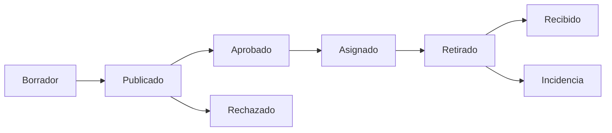

# Modelo de la demo Jopói

Estado: alcance confirmado globalmente en Q31; fase de specs previa al código. Fuente vigente: [alcance de la demo](alcance-demo.md). Este modelo describe lo acordado, no una implementación existente.

## Participantes representados

La experiencia representa generador, coordinador, transportista y comprador. Un mismo visitante cambia de rol para recorrer la operación. Ese cambio no acredita identidad de terceros ni constituye su firma independiente.

El visitante accede sin registrarse. Puede modificar sus datos de prueba; no los de otra sesión. La separación se aplica en el servidor. El mecanismo técnico se concreta durante la implementación sin cambiar este límite.

## Relaciones acordadas

| Concepto | Relación en esta entrega | Límite |
| --- | --- | --- |
| Lote | Material de un generador, con origen y características declaradas. | Solo chips forestales sin tratar; cantidad ficticia. |
| Operación | Vincula un lote completo con un comprador y un viaje. | Sin división del lote ni consolidación con otros lotes. |
| Viaje | Traslada la carga de la operación de origen a destino. | Sin GPS real ni integración con flotas. |
| Identificación QR | Identifica lote/carga y permite abrir su trazabilidad. | No autoriza acciones ni exige precinto por recipiente. |
| Evidencia | Fotos y comprobante de pesaje de ejemplo asociados al recorrido. | Precargados y ficticios; sin subida de archivos. |
| Solicitud de demo | Nombre, email, empresa y mensaje opcional. | Dato real de contacto, separado de la actividad ficticia. |

## Acciones y consulta

El QR abre una consulta compartible y de solo lectura, sin registro. Las confirmaciones de retiro y recepción se ejecutan por separado dentro de la sesión autorizada. La página pública muestra solo datos ficticios de la operación y su prueba de red; no contiene contactos ni credenciales de sesión.

Las acciones persisten en PostgreSQL mediante Prisma; los metadatos variables pueden usar JSONB. Publicación, aprobación o rechazo, asignación, retiro y recepción o incidencia se registran en HCS testnet con firma del servidor Jopói. Borradores y navegación no generan transacciones. Las solicitudes de contacto no forman parte de esos registros públicos.

Ante un fallo se conserva la acción en SQL y su registro pendiente, se permite continuar y se comprueba el resultado antes de reenviar. Hasta tres intentos automáticos y reintento manual acotado; no se simula una confirmación. Q28 sustituyó la revisión horaria por intentos durante la interacción, reintento manual y barrido automático diario. Ver [flujo y trazabilidad](flujo-y-trazabilidad.md).

## Estados acordados

La siguiente es la secuencia visible del recorrido, no la decisión de guardar todos los estados en una única entidad. Borrador, publicado, aprobado y rechazado describen la preparación y revisión del lote; asignado, retirado, recibido e incidencia describen su ejecución.

Rechazo e incidencia cierran ese recorrido. No se editan eventos anteriores ni se resuelven disputas. Una diferencia de peso es un ejemplo de incidencia, no una modificación retroactiva del peso declarado.

## Selección del transporte

El escenario contiene un comprador con requisitos precargados y dos viajes de ejemplo. Uno cumple las condiciones y otro es incompatible. Las reglas consideran material, capacidad, carrocería, ruta y horario, y explican la compatibilidad. El coordinador confirma la selección. No se usa GPS ni un optimizador de rutas.

## Validaciones acordadas en Q30

- Cantidad positiva y humedad declarada entre 0 y 100%.
- Bloquear aprobación cuando la humedad supera el requisito precargado del comprador.
- Bloquear asignación de un viaje incompatible.
- Peso recibido positivo. Si coincide con el declarado permite recepción conforme; si difiere exige incidencia.

La tolerancia de peso cero es una simplificación de la demo, no un estándar industrial. El peso declarado se conserva en el historial aunque el recibido sea diferente. La implementación debe comparar cantidades con precisión explícita, sin introducir tolerancias por redondeo accidental.

## Sesión, reinicio y contactos

La sesión anónima dura 24 horas desde su creación y permite modificar solo datos propios. Iniciar otro recorrido no elimina registros ya enviados a testnet ni renueva la sesión. El mecanismo técnico para autorizar modificaciones queda para la implementación.

Se permiten tres recorridos por sesión, incluido el inicial, y un límite global configurable de 100 mensajes HCS diarios. Las cuotas se aplican en servidor y el agotamiento se muestra sin una confirmación ficticia.

Los datos operativos vencen siete días después de crear el recorrido y los contactos 90 días después de enviarlos. El acceso a datos operativos vencidos se bloquea y la limpieza ocurre en la siguiente ejecución diaria exitosa. Las solicitudes se consultan mediante CSV desde una herramienta interna privada. No se incluye un panel administrativo público.

## Explicación económica

La demo desglosa material, transporte y tarifa Jopói, y compara con una alternativa de transporte. Importes y ahorro son ilustrativos. No representan cotizaciones actuales, resultados de operaciones ni una decisión definitiva de monetización.

## Casos límite ya resueltos

- Abrir un QR de otra sesión no otorga permiso para modificarla.
- Cambiar de rol no crea una segunda identidad independiente.
- Un lote que requeriría dos compradores o un viaje que consolidaría varios lotes no se modela en esta entrega.
- Una foto o un pesaje precargado nunca se presenta como prueba de una operación real.
- Completar el formulario de contacto no reserva automáticamente un horario ni dispara correos.

Los campos editables y sus roles se aceptaron en Q23 y las validaciones en Q30. Q27 fijó finalidad de prototipo personal con formulario real para conocerlo; Q28 barrido diario y Q29 Neon Free. No quedan decisiones de producto abiertas en este modelo; el mecanismo de aislamiento y las verificaciones se concretan durante la implementación.
