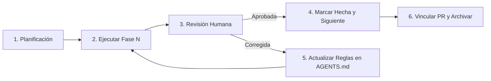

# Metodología de Planes por Fase para Agentes de IA

Esta carpeta alberga los planes de ejecución por fases diseñados para el trabajo supervisado con agentes de inteligencia artificial y desarrolladores en **Jopói**.

---

## 1. El ciclo de trabajo por fases

Para cualquier cambio que involucre lógica de negocio, persistencia, contratos de API o refactorizaciones estructurales, el flujo de trabajo sigue rigurosamente el ciclo de 6 pasos:

1. **Crear el plan:** Redactar un archivo `docs/plans/AAAA-MM-DD_nombre-tarea.md` utilizando la plantilla [`0000-template.md`](0000-template.md). El plan divide la tarea en 2 a 4 fases atómicas con criterios de salida verificables.
2. **Ejecución aislada:** Indicar al agente: *«Leé el plan docs/plans/... y ejecutá únicamente la Fase 1»*.
3. **Revisión humana:** El desarrollador o revisor valida el resultado (pruebas en verde, criterios de la fase cumplidos, reglas del negocio respetadas).
4. **Avance:** Si la fase es correcta, se marca su estado como `Hecha` en el documento y se autoriza la ejecución de la fase siguiente.
5. **Retroalimentación continua:** Si el agente cometió un error por ambigüedad o falta de contexto, **se incorpora la regla o aclaración omitida a `AGENTS.md` o a `docs/business_rules.md`**. Así se garantiza que el error no se repita en futuras interacciones.
6. **Cierre:** Al finalizar todas las fases, se vincula el Pull Request correspondiente y se archiva el plan.

---

## 2. Convenciones de nombres

- `AAAA-MM-DD_descripcion-corta.md` (ejemplo: `2026-11-15_actualizacion-documentacion.md`).
- Los planes completados permanecen en esta carpeta o pueden moverse a una subcarpeta `docs/plans/archivo/` al finalizar el hito.
