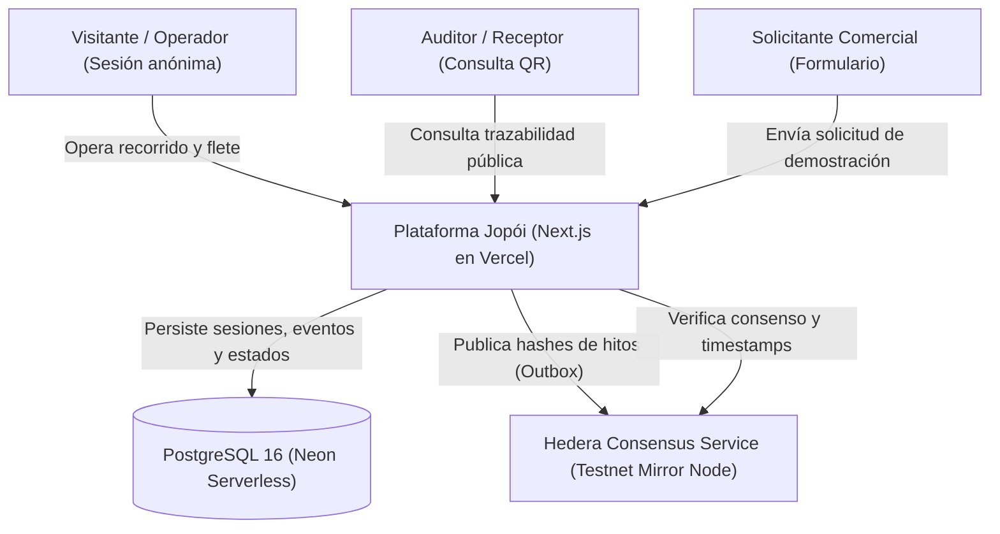
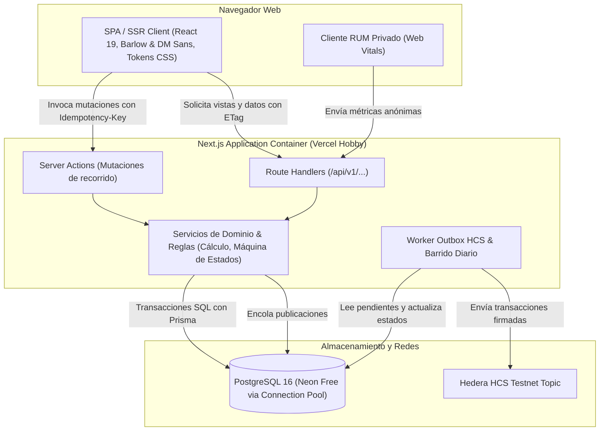

# Documento de Arquitectura de Software (SAD) — Jopói

Este documento describe la arquitectura técnica de **Jopói** adoptando la estructura [arc42](https://arc42.org/) (versión sintetizada) y diagramas del [modelo C4](https://c4model.com/).

---

## 1. Objetivos de calidad

Los tres atributos de calidad prioritarios que guían las decisiones del sistema son:

1. **Integridad y Verificabilidad Criptográfica:** Garantizar que los hitos operativos registrados en Hedera Consensus Service (HCS) coincidan de forma determinista y reproducible con los datos locales mediante el estándar RFC-8785 (JCS) y SHA-256.
2. **Presupuesto Cero y Resiliencia Operativa:** Operar de manera continua y estable dentro de los límites gratuitos de Vercel Hobby, Neon Serverless y Hedera Testnet, tolerando suspensiones temporales de base de datos o congestión en la red sin perder datos locales.
3. **Mantenibilidad y Accesibilidad:** Código TypeScript fuertemente tipado en 4 capas desacopladas, interfaces con contraste conforme a WCAG 2.1 nivel AA y suites automatizadas de pruebas con ejecución reproducible.

---

## 2. Restricciones técnicas

- **Plataforma de Hosting:** Vercel Hobby (plan gratuito, ejecución serverless en Edge/Node.js).
- **Base de Datos:** PostgreSQL 16 provisto por Neon Serverless (Vercel Marketplace) con pool de conexiones transaccionales y soporte JSONB.
- **Red de Trazabilidad:** Hedera Hashgraph HCS testnet, con firmas emitidas por la clave operadora del servidor Jopói (sin wallets de usuario).
- **Entorno de Ejecución:** Node.js v24.x LTS y Next.js 16 (App Router).
- **Presupuesto Financiero:** Cero dólares ($0.00). Prohibición de suscripciones SaaS de pago, tarjetas de crédito activas o upgrades automáticos.

---

## 3. Contexto del sistema (C4 Nivel 1)

El siguiente diagrama ilustra los usuarios principales y los sistemas externos con los que interactúa Jopói:

---

## 4. Estrategia de solución

- **Monolito Modular en Next.js (App Router):** Unifica la interfaz de usuario, las acciones del servidor y los endpoints de API en una única base de código TypeScript, simplificando el despliegue y las pruebas.
- **Arquitectura en 4 Capas Desacopladas:**
  1. *Transporte:* `src/app/` y `src/app/api/` (gestiona HTTP, Server Actions y negociación de contenido).
  2. *Validación y Contratos:* `src/contracts/` (define esquemas Zod discriminados para comandos y respuestas).
  3. *Dominio:* `src/domain/` y `src/services/` (reglas puras de compatibilidad, máquina de estados y cálculo sin dependencias de infraestructura).
  4. *Persistencia:* `src/server/db/` (Prisma ORM) y `src/server/hcs/` (cliente Hedera SDK).
- **Patrón Outbox para Emisión a Hedera:** Toda acción mutante se guarda atómicamente en PostgreSQL junto con el evento generado y su estado de publicación (`QUEUED`). Un proceso asíncrono gestiona el envío a HCS, aislando al usuario de demoras en la red blockchain.
- **Observabilidad In-House:** Recolección de RUM privado mediante balizas (*beacons*) propias sin depender de servicios de telemetría externos que violen la privacidad o impliquen costos.

---

## 5. Contenedores del sistema (C4 Nivel 2)

---

## 6. Conceptos transversales

### Autenticación y Manejo de Sesiones
- Identidad anónima basada en tokens criptográficos seguros (SHA-256) almacenados en cookies con prefijo `__Host-`, atributo `HttpOnly`, `SameSite=Strict` y `Secure`.
- Duración máxima de sesión de 24 horas.

### Idempotencia y Concurrencia
- Cabecera `Idempotency-Key` en todas las operaciones mutantes para evitar duplicación de eventos ante reintentos.
- Control de concurrencia optimista con cabeceras `ETag` e `If-Match` en las consultas y actualizaciones operativas.

### Manejo de Errores y Diagnósticos
- Respuestas de error estandarizadas bajo la especificación **RFC-7807/9457 (Problem Details)** con tipado estricto.
- Trazas correlacionadas mediante cabecera `traceparent` (W3C TraceContext) para depuración integral entre cliente, API y base de datos.

### Seguridad y Hardening
- Content Security Policy (CSP) estricta sin scripts inline no autorizados.
- Limitadores de tasa (*rate limiters*) en memoria y base de datos para prevenir abusos en endpoints públicos.

---

## 7. Riesgos y deuda técnica

| Riesgo / Deuda | Impacto | Mitigación Implementada |
| :--- | :--- | :--- |
| **Suspensión de Neon por inactividad** | Demora de 2 a 3 segundos en el primer acceso tras período de inactividad. | Advertencias en UI, pooling de conexiones optimizado y reintentos automáticos. |
| **Latencia variable en Hedera Mirror Node** | Demoras en la verificación del timestamp de consenso tras la emisión. | Interfaz con separación de estado operativo vs. estado de verificación de red. |
| **Límite de 100 mensajes diarios HCS** | Agotamiento del cupo diario en testnet ante alto tráfico. | Pausa controlada (`PAUSED_QUOTA`), conservación local en PostgreSQL y reanudación automática al día siguiente. |

Para consultar decisiones arquitectónicas históricas, ver [docs/adr/](adr/).
