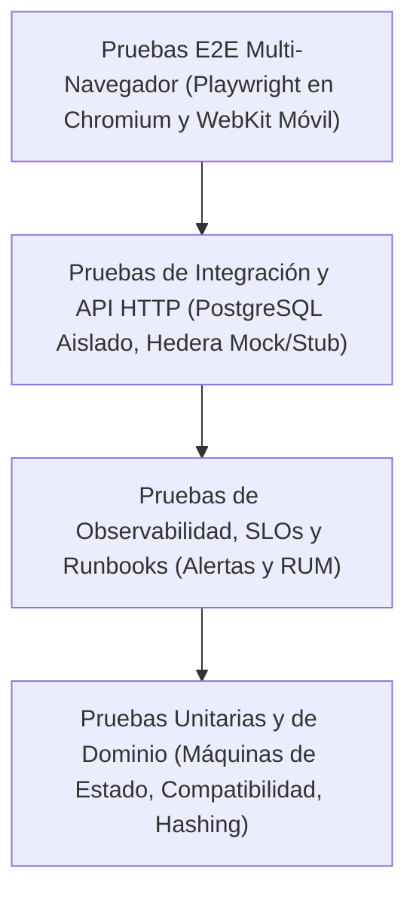

# Estrategia de Pruebas y Verificación — Jopói

Este documento describe la pirámide de pruebas, el nivel de aislamiento de cada suite, los comandos de ejecución y las puertas de calidad automatizadas del proyecto.

---

## 1. Pirámide de pruebas y aislamiento



| Nivel de Prueba | Ubicación | Qué valida | Entorno y Dependencias |
| :--- | :--- | :--- | :--- |
| **Dominio y Reglas** | `tests/rules/`, `tests/unit/` | Invariantes `RN-01` a `RN-10`, compatibilidad quíntuple de flete, máquinas de estado y hashes RFC-8785. | Node test runner nativo. Memoria pura, sin base de datos ni red. |
| **Diseño y Tokens** | `tests/ui/` | Contraste de colores WCAG AA (4.5:1), correspondencia entre `DESIGN.md` y `globals.css`. | Node test runner (`tokens.test.ts`). |
| **API e Integración** | `tests/api/` | Endpoints HTTP, sesiones seguras, CSRF, control de concurrencia `ETag`, transacciones Prisma. | PostgreSQL real aislado (local o contenedor de test). Hedera controlado/stub. |
| **Observabilidad** | `tests/observability/` | Evaluación de alertas, cálculo de burn rate de SLOs, ingestión de RUM privado y links a runbooks. | Node test runner + mocks de tiempo/telemetría. |
| **E2E Navegador** | `tests/e2e/` | Recorrido interactivo de los 4 roles en escritorio y móvil, generación y lectura de código QR. | Playwright (Chromium y WebKit emulado). Servidor Next.js activo. |
| **Puertas de Release** | `scripts/` | Verificación de matrices de cumplimiento, cobertura de historias de usuario y preparación de entrega. | Scripts TypeScript compilados (`release-gate.ts`, `candidate-acceptance.ts`). |

---

## 2. Comandos de ejecución

### 2.1 Pruebas rápidas y de dominio (Unitarias)
```bash
npm test
```
*Ejecuta todas las pruebas unitarias y de dominio con Node.js test runner nativo en menos de 5 segundos.*

### 2.2 Pruebas de integración HTTP y persistencia
```bash
npm run test:api
```
*Requiere base de datos PostgreSQL activa con variables configuradas en `.env`.*

### 2.3 Pruebas de observabilidad y alertas
```bash
npm run test:observability
```
*Valida el catálogo de 4 runbooks, cálculo de SLOs y contratos de RUM privado.*

### 2.4 Pruebas de extremo a extremo (E2E)
```bash
npm run test:e2e
```
*Inicia la instancia de Next.js y ejecuta los recorridos automatizados en navegadores headless.*

### 2.5 Verificación de tipos y linting estricto
```bash
npm run typecheck
npm run lint
```

### 2.6 Puerta de calidad y acreditación de release
```bash
npm run release:gate
```
*Verifica la matriz completa de criterios de aceptación de la especificación S22.*

---

## 3. Política de Mocks y Dependencias Externas

- **Base de Datos:** Para pruebas de API e integración, se utiliza una base de datos PostgreSQL real (local o Neon dev branch) para garantizar que los tipos de datos JSONB, restricciones referenciales `RESTRICT` y bloqueos de concurrencia funcionen exactamente como en producción.
- **Hedera Hashgraph:**
  - En pruebas unitarias y de integración local, el cliente HCS se sustituye por un *stub* determinista controlado que devuelve recibos de transacción simulados sin consumir cuota del faucet testnet.
  - La verificación contra Hedera testnet real se ejecuta exclusivamente en los ensayos de acreditación de candidato con credenciales explícitas.
- **Servicios Externos:** No existen dependencias SaaS de terceros (sin Stripe, Auth0 ni Sentry); el 100% de la lógica se verifica de forma local y soberana.
